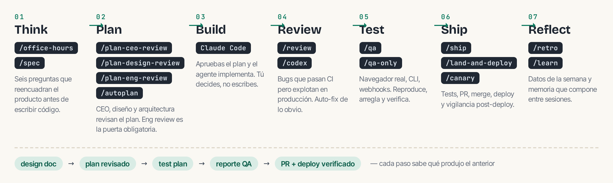

# gstack es un proceso: el sprint

- **Cada skill alimenta a la siguiente**: `/office-hours` escribe un design doc que `/plan-ceo-review` lee; `/plan-eng-review` escribe un test plan que `/qa` recoge; `/review` caza bugs que `/ship` verifica arreglados.
- Nada se cae entre grietas porque **cada paso sabe qué produjo el anterior**.
- La regla de oro del autor: si vas a usar solo un comando, usa varios de este orden — no comandos sueltos al azar.
