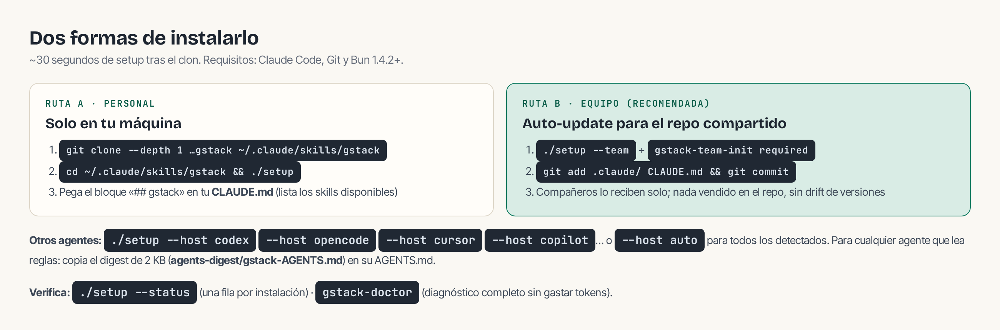

## Requisitos

- [Claude Code](https://docs.anthropic.com/en/docs/claude-code) (o el agente donde lo vayas a instalar)
- [Git SCM](https://git-scm.com/)
- [Bun](https://bun.sh/) **v1.4.2+** — la versión probada; el setup rechaza Bun < 1.3.3 porque permitiría que los binarios compilados lean el `.env` de un proyecto
- Node.js solo en Windows (Bun tiene un bug conocido con el transporte de Playwright allí)
- Opcional en macOS 15+: el navegador [Aside](https://aside.com) — los skills de navegador lo usan primero, con tus sesiones reales. Sin él, `./setup` compila el Chromium incluido de gstack y todo funciona igual.
- `/cso` necesita además toolchain nativa (Xcode CLI tools en macOS, MSVC Build Tools en Windows, gcc/clang en Linux). Si falta, todo lo demás se instala y `/cso` reporta `not assessed` con el prerrequisito nombrado.

## Las dos rutas



### Ruta A — solo en tu máquina

Abre Claude Code y pega esto (Claude hace el resto):

```text
Install gstack: run git clone --single-branch --depth 1 \
https://github.com/garrytan/gstack.git ~/.claude/skills/gstack \
&& cd ~/.claude/skills/gstack && ./setup
then add a "gstack" section to CLAUDE.md that says to use the /browse skill
from gstack for all web browsing, never use mcp__claude-in-chrome__* tools,
and lists the available skills: /office-hours, /plan-ceo-review, /plan-eng-review,
/plan-design-review, /review, /qa, /ship, ... (ver bloque de abajo)
```

O a mano, que es lo mismo:

```bash
git clone --single-branch --depth 1 https://github.com/garrytan/gstack.git \
  ~/.claude/skills/gstack
cd ~/.claude/skills/gstack && ./setup
```

El `./setup` tardó **31 segundos** en una máquina cloud de 4 vCPU (incluye compilar binarios y descargar Chromium). El último paso es añadir la sección gstack a tu `CLAUDE.md` — sin ella, Claude «no ve» los skills:

```markdown
## gstack
Use /browse from gstack for all web browsing. Never use mcp__claude-in-chrome__* tools.
Available skills: /office-hours, /plan-ceo-review, /plan-eng-review, /plan-design-review,
/design-consultation, /design-shotgun, /design-html, /review, /deslop-shared-libs,
/test-audit, /ship, /land-and-deploy, /canary, /benchmark, /browse, /qa, /qa-only,
/design-review, /scrape, /setup-deploy, /setup-gbrain, /retro, /investigate,
/document-release, /document-generate, /codex, /cso, /autoplan, /careful, /freeze,
/guard, /unfreeze, /gstack-upgrade, /learn.
```

### Ruta B — team mode (recomendada para repos compartidos)

Desde dentro de tu repo:

```bash
(cd ~/.claude/skills/gstack && ./setup --team) && \
  ~/.claude/skills/gstack/bin/gstack-team-init required && \
  git add .claude/ CLAUDE.md && git commit -m "require gstack for AI-assisted work"
```

- Sin archivos vendidos en el repo, sin drift de versiones, sin upgrades manuales: cada sesión arranca con un chequeo de auto-update (limitado a 1×/hora, silencioso, tolerante a fallos de red).
- Cambia `required` por `optional` si prefieres sugerirselo a tus compañeros en vez de bloquearlos.

## Otros agentes

```bash
cd ~/gstack && ./setup --host auto     # todos los detectados en la máquina
./setup --status                       # una fila por instalación: host, tier, versión, ruta
```

| Host | Tier | Primera invocación |
|---|---|---|
| Claude Code | full (certificado) | `/office-hours` |
| Codex CLI, OpenCode, Cursor, Copilot CLI, Factory Droid, Kiro, Antigravity | experimental | `gstack-office-hours` o `/gstack-office-hours` |
| OpenClaw, Hermes, Slate | instruction-only | copiar el digest de 2 KB (`agents-digest/gstack-AGENTS.md`) al AGENTS.md del agente |

En hosts no-Claude los guardas de seguridad son **advisory** (no bloquean vía hooks) y la segunda opinión externa requiere el otro CLI instalado y autenticado.

## Verificar y ajustar

```bash
~/.claude/skills/gstack/bin/gstack-doctor   # diagnóstico completo, sin gastar tokens
./setup --status                            # ¿quién está instalado y desde dónde?
gstack-config set telemetry off             # telemetría: apagada por defecto
./setup --prefix                            # comandos /gstack-qa si colisionan con otros packs
./setup --no-prefix                         # por defecto: /qa corto
gstack-config set disabled_skills make-pdf  # skills que no usas: deja de registrarlos
```

## Desinstalar

```bash
~/.claude/skills/gstack/bin/gstack-uninstall   # skills, estado global, hooks, temp
```

Y en cada proyecto donde añadiste la sección, borra `## gstack` de su `CLAUDE.md`. El script acepta `--keep-state` si quieres conservar configuración y analytics.
