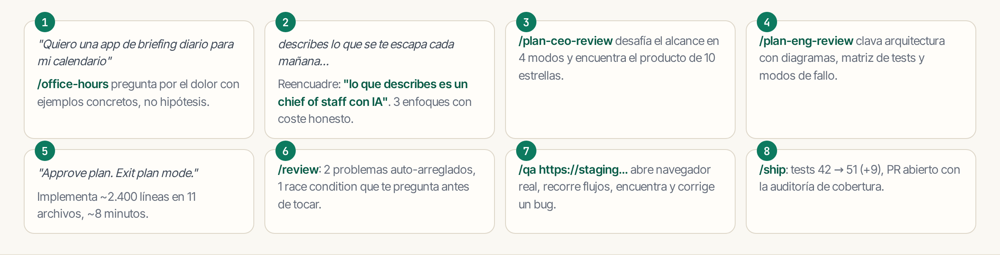

# El día completo, en una imagen

Dijiste «daily briefing app». El agente dijo «estás construyendo un chief of staff con IA» — porque escuchó tu dolor, no tu feature request.

Ocho comandos, de la idea al PR con tests nuevos. Eso no es un copiloto: **es un equipo**.
