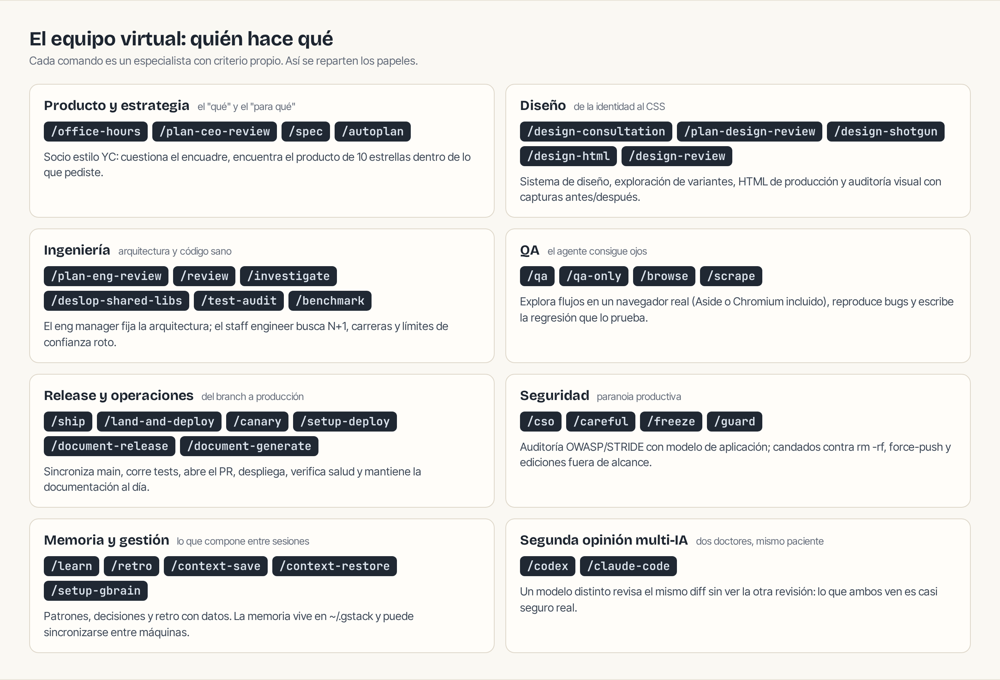
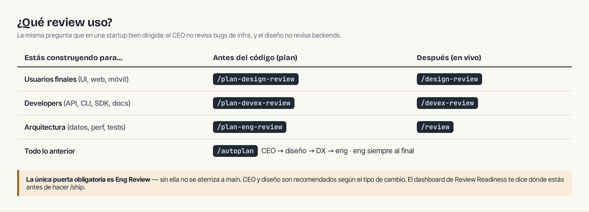

## El mapa del equipo

## ¿Qué review corresponde?

## Planificación (antes de código)

| Comando | Especialista | Qué hace | Úsalo cuando |
|---|---|---|---|
| `/office-hours` | Socio YC | Seis preguntas forzadas, reframe, premisas, 2-3 enfoques con coste; escribe design doc | Empieza aquí. Idea nueva o «¿vale la pena construirlo?» |
| `/spec` | Spec author | Cinco fases de intención vaga a spec ejecutable; gate de calidad con review externo; archiva en el corpus del proyecto | La intención está clara pero el alcance no |
| `/plan-ceo-review` | CEO/founder | Replantea el problema; 4 modos: Expansion, Selective, Hold Scope, Reduction | Desafiar el alcance del plan |
| `/plan-design-review` | Diseñador senior | Puntúa dimensiones 0-10, muestra cómo sería un 10, edita el plan; caza AI slop | Hay UI en el plan |
| `/plan-devex-review` | DX lead | Personas de developer, TTHW, momentos mágicos; 20-45 preguntas | El producto son APIs, CLIs, SDKs o docs |
| `/plan-eng-review` | Eng manager | Arquitectura, diagramas, estados, modos de fallo, matriz de tests; escribe el test plan que `/qa` recoge | **Siempre** — es la única puerta obligatoria |
| `/autoplan` | Pipeline | CEO → diseño → DX → eng, decisions automáticas + gate de taste decisions | Quieres el plan completo en un comando |

## Construcción, revisión y tests

| Comando | Especialista | Qué hace | Úsalo cuando |
|---|---|---|---|
| `/review` | Staff engineer | Bugs que pasan CI (N+1, carreras, enums sin handler…), auto-fix de lo obvio, gaps de completitud | En cada rama con cambios |
| `/investigate` | Debugger | Iron Law: nada de fixes sin causa raíz; para tras 3 arreglos fallidos | «Esto está roto y no sé por qué» |
| `/deslop-shared-libs` | Shared-code reviewer | Compara hasta 5 oportunidades de extracción y recomienda máx. 3, con evidencia | Tras un periodo de mucho código nuevo |
| `/test-audit` | Test auditor | Barre tests existentes que cuestan más de lo que protegen; nada se borra sin tu aprobación por lotes | La suite creció sin control |
| `/qa` | QA lead | Explora navegador/API/CLI/jobs/webhooks, reproduce, escribe la regresión, arregla y reverifica | Verificar que todo funciona de verdad |
| `/qa-only` | QA reporter | Lo mismo, sin tocar código ni tests; propone casos con evidencia | Auditoría o caja de arena |
| `/benchmark` | Performance | Baselines de carga, Core Web Vitals y tamaños; compara antes/después | Antes y después de cada PR de UI |
| `/health` | Dashboard | Typecheck, lint, tests, dead code → score 0-10 con tendencia | Chequeo de salud del repo |

## Release y operaciones

| Comando | Especialista | Qué hace | Úsalo cuando |
|---|---|---|---|
| `/ship` | Release engineer | Sync main, tests, auditoría de cobertura y docs, PR; bootstrap de tests si falta | La rama está lista |
| `/land-and-deploy` | Release engineer | Merge, espera CI y deploy, verifica salud en producción | El PR está aprobado |
| `/canary` | SRE | Bucle post-deploy: errores de consola, rendimiento, fallos de página | Tras cada deploy (y periódico si fue arriesgado) |
| `/setup-deploy` | Configurador | Detecta plataforma, URL de producción y health checks; 1 vez | Antes del primer `/land-and-deploy` |
| `/document-release` | Tech writer | Audita la docs contra el diff del release; corre en cada `/ship` | Standalone: tras existir el PR |
| `/document-generate` | Doc author | Genera docs Diataxis (tutorial/how-to/reference/explanation) desde el código | Cobertura de docs con huecos |
| `/retro` | Eng manager | Retro semanal con datos por persona; `/retro global` cruza proyectos | Viernes 😄 |

## Diseño

| Comando | Especialista | Qué hace |
|---|---|---|
| `/design-consultation` | Socio de diseño | Sistema completo desde cero + `DESIGN.md`; separa elecciones seguras de riesgos |
| `/design-shotgun` | Explorador | 4-6 variantes IA + tablero comparativo; taste memory aprende de tus aprobaciones |
| `/design-html` | Design engineer | Mockup → HTML de producción (Pretext, 30 KB, cero deps) |
| `/design-review` | Diseñador que codifica | Auditoría de 80 ítems en vivo + bucle de fixes con capturas |

## Navegador

| Comando | Qué hace |
|---|---|
| `/browse` | Ojos del agente: Aside primero (tus sesiones reales), Chromium incluido como fallback |
| `/scrape` | Datos estructurados de una página (tablas, listas, precios) con tu sesión logueada |
| `/setup-browser-cookies` | Copia cookies de tu navegador al fallback (solo necesario sin Aside) |
| `/open-gstack-browser` | Abre el navegador de gstack con ventana + agente lateral |
| `/pair-agent` | Comparte el navegador con otro agente (OpenClaw, Hermes, Codex…): tokens con scope, tabs aisladas |

## Power tools y utilidades

| Comando | Qué hace |
|---|---|
| `/codex` · `/claude-code` | Segunda opinión del otro proveedor: review, challenge, consult |
| `/careful` | Avisa antes de comandos destructivos; lo catastrófico se deniega en firme |
| `/freeze <dir>` · `/unfreeze` | Encierra las ediciones en un directorio |
| `/guard` | `/careful` + `/freeze` — máximo candado para producción |
| `/learn` | Gestiona lo aprendido entre sesiones: revisar, buscar, podar |
| `/context-save` · `/context-restore` | Estado de trabajo portable entre sesiones y workspaces |
| `/make-pdf` | Markdown → PDF de calidad (con diagramas mermaid/excalidraw vectoriales), o HTML/DOCX |
| `/diagram` | Inglés entra, diagrama sale: mermaid + `.excalidraw` editable + SVG/PNG, offline |
| `/gstack-upgrade` | Se actualiza solo, detecta instalación global vs vendida |
| `/setup-gbrain` · `/sync-gbrain` | Memoria persistente entre máquinas (PGLite/Supabase) e indexación del repo |

## Binarios fuera de sesión

| Comando | Qué hace |
|---|---|
| `gstack-doctor` | Diagnóstico completo del install, sin gastar tokens |
| `gstack-egress list/verify/grants` | Recibos hash-chain de cada envío fuera de tu máquina |
| `gstack-analytics` | Dashboard de uso desde el JSONL local |
| `gstack-context-bill` | Cuánto cuesta en tokens tu árbol de skills |
| `gstack-model-benchmark` | Mismo prompt por Claude/GPT/Gemini: latencia, tokens, coste, calidad |
| `gstack-taste-update` | Escribe tu gusto de diseño en un perfil persistente con decaimiento |
