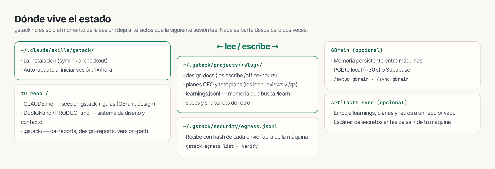

## Checklist de sesión

```text
[ ] Idea nueva o feature vaga        → /office-hours
[ ] Plan revisado sin 20 preguntas   → /autoplan
[ ] Aprobar plan · exit plan mode    → implementar
[ ] Rama con cambios                 → /review
[ ] Verificar de verdad              → /qa  (URL de staging o fixture local)
[ ] Rama lista                       → /ship
[ ] PR aprobado                      → /land-and-deploy
[ ] Deploy hecho                     → /canary https://miapp.com
[ ] Cerca de producción              → /guard  (o "be careful")
[ ] Viernes                          → /retro
```

## Dónde vive el estado



## Mantenimiento

```bash
/gstack-upgrade                                  # actualizar (o auto_upgrade: true en ~/.gstack/config.yaml)
~/.claude/skills/gstack/bin/gstack-doctor        # diagnóstico: una fila por chequeo
./setup --status                                 # instalaciones por host y su fuente
gstack-config get telemetry                      # apagada por defecto
gstack-egress list && gstack-egress verify       # auditoría de envíos externos
gstack-analytics                                 # tu dashboard local de uso
```

## Troubleshooting rápido

| Síntoma | Qué significa y arreglo |
|---|---|
| «Claude no ve los skills» | Falta la sección `## gstack` en tu `CLAUDE.md` (parte 02, Ruta A paso 3) |
| `NEEDS_ASIDE` / `ASIDE_NOT_RUNNING` | No es un error: el probe avisa que usará el navegador incluido. ¿Quieres Aside? Ábrelo, loguéate y re-ejecuta. Forzar fallback: `GSTACK_SKIP_ASIDE=1` |
| Chromium no arranca (Ubuntu 24.04+) | Namespaces de usuario bloqueados por AppArmor: `GSTACK_CHROMIUM_NO_SANDBOX=1` |
| Windows: `Permission denied` en binarios | Smart App Control bloquea binarios sin firma (#2595): usar WSL o desactivarlo |
| Instalación stale | `/gstack-upgrade` — o desde el checkout: `git pull && ./setup` (en Windows sin Dev Mode, tras cada pull) |
| Codex: «Skipped loading skill(s)» | Descripciones stale: `cd <source de ./setup --status> && git pull && ./setup --host codex` |
| Estado en el sitio equivocado | `gstack-paths --explain` — muestra qué directorio usa y por qué |
| ¿Qué salió mal en general? | `gstack-doctor`; su salida se pega tal cual en bug reports |
| Mensaje `not run` / `unavailable` | Índice completo de gates y su fix: `docs/troubleshooting.md` del repo |

## Memoria que compone

- **`/learn`** — lo que gstack aprendió de tu proyecto (patrones, pitfalls, preferencias) en `~/.gstack/projects/<slug>/learnings.jsonl`. Las demás skills lo consultan antes de recomendar.
- **`/context-save` / `/context-restore`** — el estado de trabajo (git, decisiones, pendientes) viaja entre sesiones y workspaces.
- **`/setup-gbrain`** — memoria persistente entre máquinas: PGLite local (~30 s, cero cuentas) o Supabase; registra gbrain como MCP y añade la guía de búsqueda a tu CLAUDE.md.
- **Artifacts sync** (`gstack-artifacts-init`) — learnings, planes y retros a un repo privado, con escáner de secretos antes de salir de tu máquina.
- **Privacidad** — telemetría opt-in (nunca envía código, rutas ni prompts); cada envío externo deja recibo verificable; `gstack-config set telemetry off` lo apaga todo.

## Uninstall

```bash
~/.claude/skills/gstack/bin/gstack-uninstall     # --keep-state conserva config y analytics
```

Después, borra las secciones `## gstack` y `## Skill routing` del `CLAUDE.md` de cada proyecto donde las añadiste.
